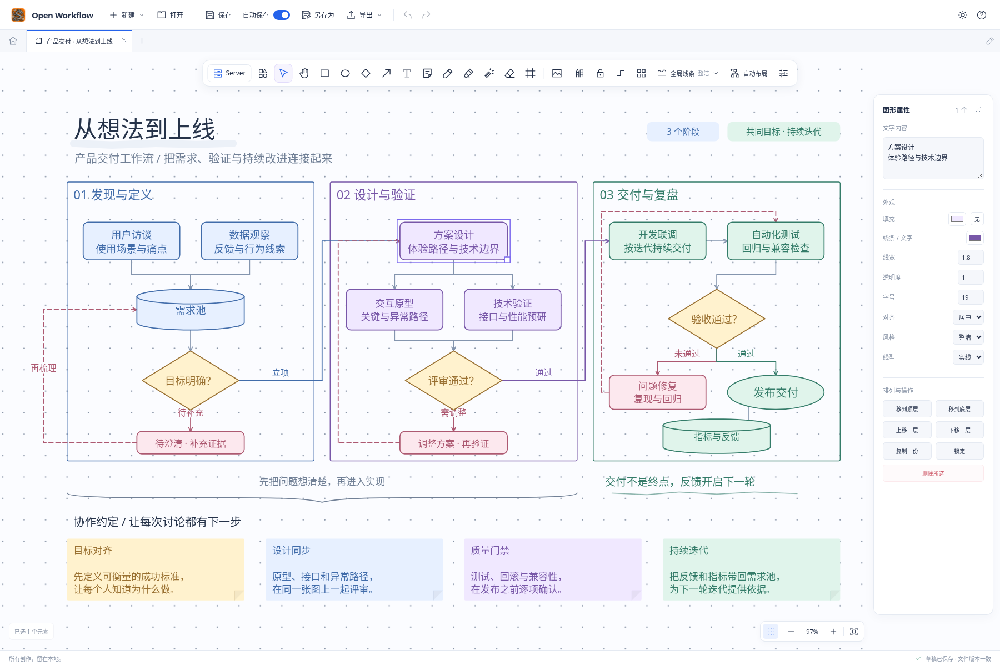
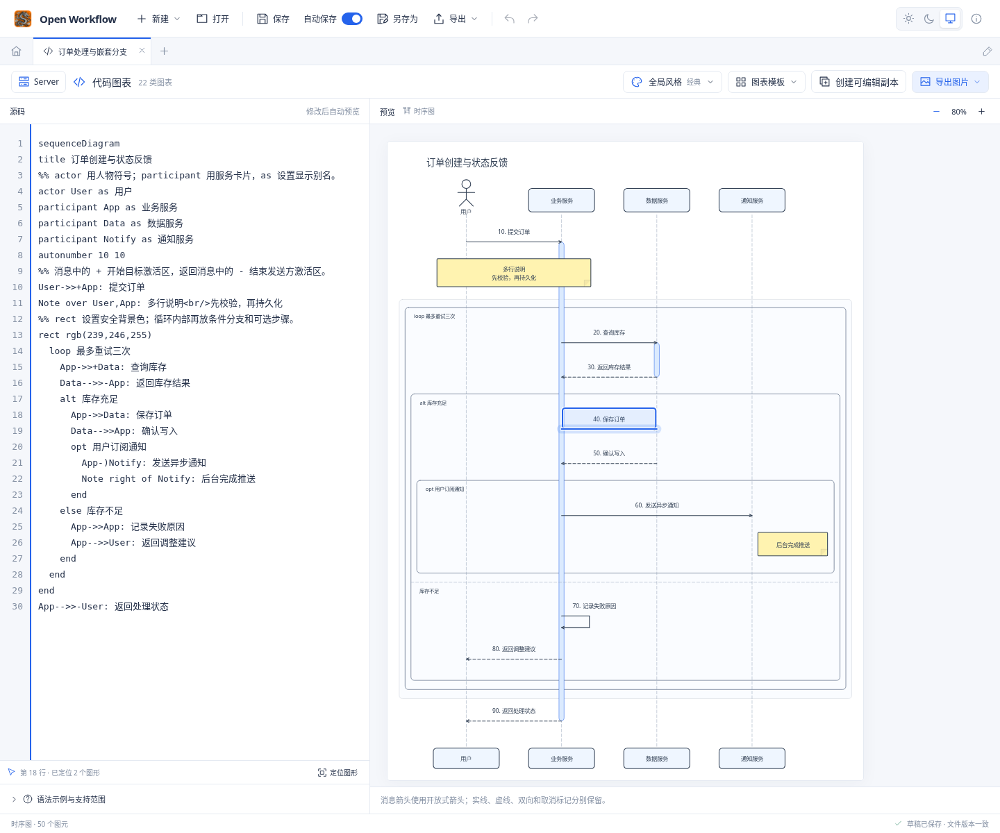

# Open Workflow

> [!IMPORTANT]
> **停止维护说明**
>
> Open Workflow 的功能已集成到 Open Office，本项目后续不再维护。如有需要，请移步 [Open Office](https://github.com/ecojust/open-office)。

把流程图、自由白板与代码图表放在同一个本地工作台。

## 功能概览

| 功能 | 简介 |
| --- | --- |
| 统一画布 | 流程图与自由白板共用画布，支持多种图形、大括弧、自动吸附连线、图层、组合与对齐。 |
| 手绘与整理 | 六种笔触、触笔压感、便签、图片、分区框架和激光指示，内置头脑风暴、任务看板、会议复盘等模板。 |
| 代码图表 | 22 类图表、46 个带中文注释的模板，源码修改自动预览，光标与图形高亮同步，可生成独立画布副本。 |
| 绘图风格 | 画布可统一线条外观；代码图表提供经典、极简、蓝图、水墨、手绘等 10 种全局风格。 |
| 文档管理 | 多文档标签、本地草稿自动保存与恢复、撤销重做，以及未保存文档的退出保护。 |
| 局域网共享 | 桌面端开启 Server 后，可通过局域网网页访问并编辑当前文档，修改双向同步。 |
| 文件与导出 | 原生 `.owflow` 文档、图形 XML、白板 JSON、文本图表导入导出，以及 SVG / PNG 图片导出。 |
| 界面主题 | 浅色、深色与跟随系统，应用信息显示版本和构建时间。 |

## 画布示例

产品交付工作流：从需求发现、方案验证到发布复盘，结合分区、并行任务、判断与返工回路、彩色便签、大括弧和手绘标注。

<picture>
  <source media="(prefers-color-scheme: dark)" srcset="docs/screenshots/workflow-cover-dark.png">
  
</picture>

[可编辑示例画布](docs/examples/product-delivery.owflow)

## 代码图表示例

用文字描述结构、关系和数据，自动生成流程图、时序图、类图、甘特图、思维导图及多种统计图。下面的“订单处理与嵌套分支”展示消息编号、激活区、循环、条件分支、可选通知与源码定位高亮。

[可编辑示例文档](docs/examples/order-processing.owflow) · [完整示例源码](docs/examples/order-processing.mmd) · [图表类型与语法范围](docs/DIAGRAM_SYNTAX.md)

## 下载与文档

[历史版本下载](https://github.com/ecojust/open-workflow/releases) · [使用与开发说明](docs/GUIDE.md) · [桌面版](docs/DESKTOP.md) · [局域网共享](docs/SHARING.md) · [文件格式](docs/FORMATS.md) · [架构说明](docs/ARCHITECTURE.md)

项目原创代码采用 [MIT](LICENSE) 许可，第三方归属说明见 [THIRD_PARTY_NOTICES.md](THIRD_PARTY_NOTICES.md)。
