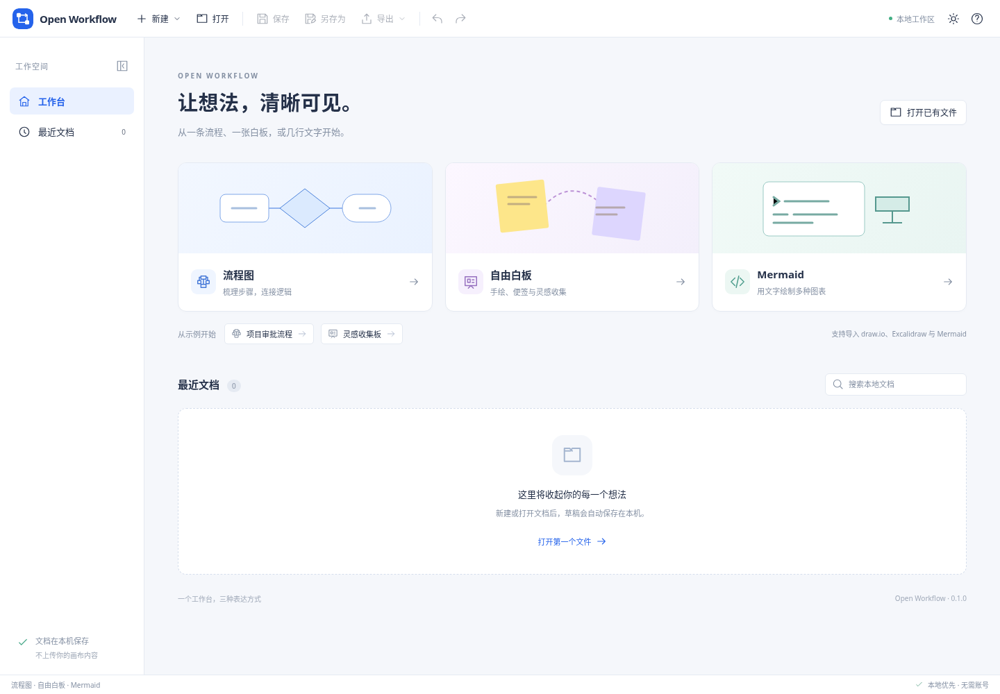
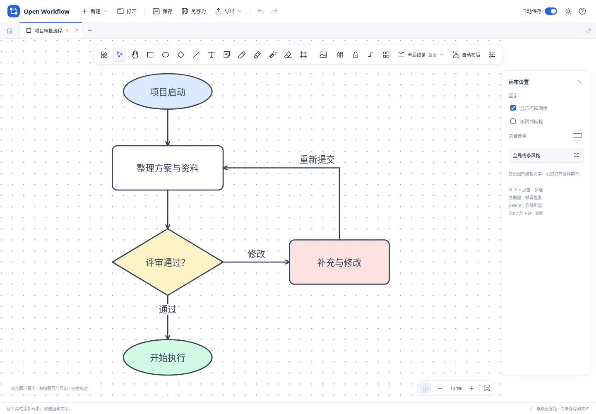

# Open Workflow

把流程图、自由白板与代码图表放在同一个本地工作台。

Open Workflow 提供“画布”和“代码图表”两个入口。流程绘制与自由白板共用画布，可从空白开始，也可插入模板。场景模型、SVG 绘制、节点连线、手绘、布局、撤销历史与格式转换均由本项目实现。自研设计结论见 [RESEARCH.md](docs/RESEARCH.md)，依赖归属和许可见 [THIRD_PARTY_NOTICES.md](THIRD_PARTY_NOTICES.md)。



## 当前功能

- **画布绘图**：矩形、椭圆、菱形、三角形、六边形、星形、平行四边形、圆柱、云形，以及四方向大括弧、文字、便签和自动布局。大括弧使用开放曲线，文字位于内侧；连线靠近真实轮廓时吸附，支持拖动端点重连及随图形移动。
- **多种笔触**：圆头笔、铅笔、马克笔、毛笔、荧光笔和彩虹笔分别呈现不同笔迹，可调颜色、粗细、透明度和平滑程度，支持触控笔压感；已有笔迹也可切换笔触。笔迹随文档保存并参与撤销重做，预览与图像导出使用同一套绘制规则。
- **自由整理**：按元素擦除的橡皮擦、彩色便签、本地 PNG/JPEG/WebP 图片与分区框架；拖动框架可带动完整包围的未锁定内容。提供组合/取消组合、六种对齐及水平/垂直等距分布。激光指示用于临时讲解，轨迹自动淡出，不进入文档或导出。
- **画布模板**：流程图、白板、头脑风暴、四象限分析、任务看板、会议复盘，一次插入可编辑图形与便签，保留已有内容；插入后可以整体撤销。旧流程图和白板文档仍可直接打开。
- **画布操作**：平移缩放、自适应点阵与悬浮工具栏，右下角可直接开关点阵，灰色或深色背景也保持清晰。图形素材库默认收起，所有工作区的操作图标统一使用 SVG。
- **绘制设置**：开启工具锁可连续绘制，按 `Esc` 返回选择；新建连线默认使用直角折线和终点箭头，绘制前可选择直线/折线及无箭头/单箭头/双箭头。
- **线条外观**：顶部“全局线条”显示当前整洁/手绘模式，可统一调整实线/虚线/点线、线宽和颜色，也可独立修改选中图形；全局设置作用于现有元素（包含锁定元素）与后续图形、连线，新笔迹使用笔触面板的独立设置。
- **直接编辑**：双击图形或连线修改文字，选择工具下双击空白处创建文字；右键菜单提供文字编辑、复制、锁定、删除，以及置顶、置底、上移一层、下移一层。
- **代码图表**：自研解析、布局与绘制覆盖 22 类图表，提供分类、搜索和各类模板，显示预览、行号、语法错误与兼容提示；左侧移动光标或选择源码，右侧同步高亮对应图形，同一行的节点与连线也可分别定位。高亮只用于编辑辅助，可创建独立的画布副本继续编辑。每类支持明确的语法子集，详见 [格式说明](docs/FORMATS.md#代码图表语法子集)。
- **图表风格**：代码图表提供经典、极简、蓝图、水墨、手绘、森林、海洋、落日、紫雾、夜色十种全局风格，统一作用于整张图；预览、图像导出与可编辑副本保持一致，风格随原生文档和草稿保存，并支持撤销重做。
- **统一工作台**：多文档标签、重命名、最近文档搜索、浅色/深色/跟随系统外观，以及本地草稿恢复。
- **文件与导出**：原生 `.owflow`；图形 XML、白板 JSON 和文本图表导入导出；整图或选区 SVG/PNG 导出。导入时的原始文本可单独取回，兼容扩展名和结构见格式说明。

22 类文字图表包括：流程图、时序图、类图、状态图、实体关系图、分支历史图、需求图、系统上下文图、架构图；饼图、甘特图、柱线图、象限图、桑基图、雷达图、矩形树图；思维导图、时间线、用户旅程、看板、块图和数据包图。统计图使用实际扇区、时间轴、坐标轴、流带或面积布局，生成可编辑场景元素。



[查看全局线条设置](docs/screenshots/flow-style.png) · [查看右键菜单](docs/screenshots/flow-context.png)

[查看自由白板](docs/screenshots/board.png) · [查看白板模板面板](docs/screenshots/whiteboard-templates.png) · [查看 22 类图表模板库](docs/screenshots/diagram-library.png)

[查看代码图表](docs/screenshots/diagram.png) · [查看十种全局绘图风格](docs/screenshots/diagram-styles.png)

[查看四方向大括弧](docs/screenshots/canvas-braces.png) · [查看窄屏画布](docs/screenshots/canvas-mobile.png)

[查看六种笔触与设置](docs/screenshots/canvas-brushes.png) · [查看源码光标与图形联动](docs/screenshots/diagram-cursor.png)

## 运行

需要 Node.js 24 和 npm。

```sh
npm ci
npm run dev
```

打开 <http://127.0.0.1:5199>。生产构建和预览：

```sh
npm run build
npm run preview
```

检查与浏览器测试：

```sh
npm test
npx playwright install chromium
npm run test:browser
```

单独检查统一画布、自动保存开关、大括弧及绘制设置：

```sh
node tests/browser/canvas-workspace.cjs
```

单独检查六种笔触、激光指示与代码光标定位：

```sh
node tests/browser/brush-cursor.cjs
```

`test:browser` 使用真实 Chromium，并在未设置 `BASE_URL` 时按需启动和关闭开发服务，默认端口为 5199；已有浏览器可通过 `CHROMIUM_EXECUTABLE` 指定。也可先运行生产构建与预览，再用 `BASE_URL=http://127.0.0.1:5199 npm run test:browser` 验证该服务。各套件的截图与结果默认写入 `/tmp/open-workflow-*` 目录，笔触与光标定位套件使用 `/tmp/open-workflow-brush-cursor`；可通过 `BROWSER_ARTIFACTS` 更改。Linux 测试环境缺少浏览器系统库时，可使用 `npx playwright install --with-deps chromium`。

桌面开发使用 `npm run desktop:dev`，构建使用 `npm run desktop:build`；另需 Rust 和系统构建依赖，见 [桌面版说明](docs/DESKTOP.md)。仓库配置了 Windows x64、Mac Apple Silicon 与 Mac Intel 构建，开发产物可保存在 Actions artifacts。正式安装包从 [版本发布页](https://github.com/ecojust/open-workflow/releases/latest) 下载；发布流程见 [发布约定](.github/RELEASING.md)。

## 保存到哪里

顶部“自动保存”默认开启，并记住当前设备的选择。开启时，修改自动写入当前浏览器或桌面工作区的 **IndexedDB 草稿库**，不会自动写入或覆盖原文件。状态栏分别显示草稿状态与文件保存状态；草稿只属于当前设备和工作区，清除站点数据会移除草稿。

关闭自动保存会取消尚未执行的自动写入，已开始的写入可能完成，已经保存的草稿保留。重新开启会先提交正在编辑的内容，再补存所有打开标签的最新草稿。关闭开关后，未保存修改仍有关闭或离开保护。

手动“保存”始终保存文件并同步本地草稿，不受自动保存开关影响。浏览器中的保存下载文件；桌面版使用系统文件选择器，可以保存回本次会话中打开的原生文件，覆盖前会检查文件是否被其他程序修改。从草稿恢复的文档需要重新选择保存位置。关闭有未保存文件修改的标签时，可保存、放弃或取消；**放弃修改同时移除该文档的本地草稿**。需要备份、迁移或分享时，请保存 `.owflow` 文件。

导入图形 XML、白板 JSON 或文本图表后，保存会生成 `.owflow` 副本。转换限制会在导入结果中显示，原始文本保留在副本中，“导出 → 导入时的原文件”可取回导入时的内容。

## 常用操作

下表中的 `Ctrl` 在 macOS 上也可使用 `⌘`。画布快捷键需要焦点位于画布；输入文字时保留文本编辑行为。

| 操作 | 快捷键 / 手势 |
| --- | --- |
| 新建画布 / 打开文件 | `Ctrl+N` / `Ctrl+O` |
| 保存 / 另存为 | `Ctrl+S` / `Ctrl+Shift+S` |
| 撤销 / 重做 | `Ctrl+Z` / `Ctrl+Shift+Z` 或 `Ctrl+Y` |
| 平移画布 | 普通滚轮；按住空格拖动；鼠标中键拖动 |
| 缩放画布 / 适应内容 | `Ctrl` + 滚轮 / `0` |
| 多选 / 框选 | `Shift` 点击 / 在空白处拖动 |
| 组合 / 取消组合 | `Ctrl+G` / `Ctrl+Shift+G`；普通点击选择整组，`Alt` 点击选择组内成员 |
| 复制 / 粘贴 / 创建副本 | `Ctrl+C` / `Ctrl+V` / `Ctrl+D`，作用于当前编辑器内 |
| 删除 / 微调位置 | `Delete` 或 `Backspace` / 方向键，按住 `Shift` 移动 10 个画布单位 |
| 编辑文字 / 新建文字 | 双击图形或连线；选中后按 `Enter`；选择工具下双击空白处新建 |
| 重新连接端点 | 选中连线，拖动端点圆柄；距图形真实轮廓 14 个屏幕像素内自动吸附 |
| 图层、锁定与图像导出 | 右键打开菜单；选中元素后可导出选区 SVG/PNG |
| 选择 / 平移 / 连线 / 画笔 | `V` / `H` / `L` / `P` |
| 矩形 / 椭圆 / 菱形 / 文字 / 便签 | `R` / `O` / `D` / `T` / `N` |
| 荧光笔 / 橡皮擦 / 分区框架 | `M` / `E` / `F` |
| 笔触设置 / 激光指示 | 点击工具栏“笔触设置”选择类型与参数 / `K` |
| 连续绘制 / 返回选择 | 点击工具栏的工具锁，默认关闭；`Esc` 关闭工具锁并返回选择 |
| 等宽高绘制 | 绘制矩形、椭圆、菱形、三角形、六边形、星形时按住 `Shift` |
| 代码定位图形 | 在源码中移动光标或拖选；点击“定位图形”将当前图形滚动到预览中央 |

工具锁和新建连线的路径、箭头默认值只属于当前编辑器，不写入文档；它们不会批量修改已有元素。实际创建的连线会将自己的路径与箭头随文档保存。

笔触设置用于接下来绘制的笔迹，可分别调整粗细、不透明度、平滑和触笔压感，各类型记住当前编辑器中的设置。六种笔触均可随触笔压力变化粗细，鼠标使用稳定压力；荧光笔保留透色效果，彩虹笔沿笔迹变化颜色，不使用单色设置。激光指示松开后自动淡出，按 `Esc` 清除轨迹并返回选择。

代码图表的高亮跟随光标或选区，不会因光标移动反复编译或自动滚动预览。空白行、注释和编译错误不显示错误对应的高亮；正在编辑、尚未得到新预览时，也会暂时清除旧定位。需要查看画面外的目标时，使用“定位图形”。

全局线条设置只统一本次调整的属性，并保存为后续图形和连线的默认值；新笔迹的颜色、粗细和不透明度由笔触面板独立设置。单独调整图形不会改变其他元素；再次修改同一全局属性时，会覆盖各元素此前的独立设置，包含锁定元素。专用笔触保留自己的纹理、笔尖和颜色规则，不叠加整洁/手绘或虚点线外观；已有笔迹可统一调整粗细与颜色，彩虹笔保持多色。普通移动、文字编辑、图层和删除操作仍遵守锁定状态。

## 第一版的边界

图形 XML 和白板 JSON 支持基础元素转换，部分分组、扩展形状和闭合图形依靠元数据恢复，不保证其他软件中的外观或往返完全一致。代码图表的 22 类图表均为语法子集，未知指令会报错。复杂图的自动布局可能需要手动调整。

文字图表的可编辑副本由普通画布元素组成，不与源码双向同步。类图、实体关系图的装饰端标在移动卡片后不会自动重新计算；架构图端口使用自由端点，转为副本后不自动跟随节点。画布组合为单层，框架不提供裁剪或持久父子关系；橡皮擦删除整个命中元素，不逐像素擦除。大括弧在原生文档和 SVG 中保留完整形状，在外部格式中以开放线条及元数据转换，可能失去其编辑与绑定语义。

当前没有其他专有白板格式导入、多人实时协作、云同步或账号服务。文档上限与转换细节见 [FORMATS.md](docs/FORMATS.md)。

## 源码

| 目录 | 内容 |
| --- | --- |
| `src/App.vue` | 工作台、标签、保存状态与操作协调 |
| `src/components/` | 自研 SVG 画布、代码图表工作区与界面图标 |
| `src/core/` | 文档、历史、几何、布局、SVG、代码图表、存储和文件操作 |
| `src/core/diagrams/` | 图表目录、模板和 22 类文字图表共用及分类编译逻辑 |
| `src/formats/` | 图形 XML 与白板 JSON 转换 |
| `src-tauri/` | 原生窗口、文件选择、版本检查与写入 |
| `tests/` | 纯逻辑与真实浏览器交互测试 |

架构说明见 [ARCHITECTURE.md](docs/ARCHITECTURE.md)。项目原创代码采用 [MIT](LICENSE) 许可，第三方归属说明见 [THIRD_PARTY_NOTICES.md](THIRD_PARTY_NOTICES.md)。
