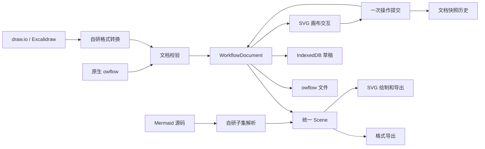

# 架构

Open Workflow 把三种表达方式统一到自己的场景模型中。Vue 3 管理工作台和编辑界面，Tauri 2 管理原生窗口与文件访问；SVG 绘制、交互、布局、Mermaid 解析和格式转换均由仓库内的代码实现。

## 数据流

图中的 Mermaid 代码仅用于文档展示，应用不依赖 Mermaid 运行库。

## 模块边界

| 模块 | 职责 |
| --- | --- |
| `src/App.vue` | 工作台、标签、当前文档、文件保存、草稿调度、全局快捷键与关闭确认 |
| `src/core/types.ts` | 文档、场景、形状、连线、笔迹和样式契约 |
| `src/core/documents.ts` | 版本和容量校验、模板、内容比较、快照历史 |
| `src/core/geometry.ts` | 边界、命中、形状交点、连线路径、场景范围 |
| `src/core/binding.ts` | 按真实图形轮廓和屏幕距离选择连线吸附目标 |
| `src/core/grid.ts` | 随视口缩放调整点阵间距、点大小和背景对比度 |
| `src/core/appearance.ts`、`src/core/sketch.ts` | 样式兼容、全局默认风格与自研手绘路径 |
| `src/core/selection.ts` | 四种图层操作、选区导出及外部节点绑定处理 |
| `src/core/board-tools.ts` | 几何命中、单层组合、对齐、等距分布和框架内容选择 |
| `src/core/board-templates.ts` | 四套可编辑白板模板，每次插入生成独立元素与组合 ID |
| `src/core/layout.ts` | 无第三方布局依赖的确定性分层布局 |
| `src/core/svg.ts` | 文本转义、基本 SVG 图元、场景导出及内嵌图片限制 |
| `src/components/SceneEditor.vue` | 工具、选区、手势、视口、文字编辑、属性面板 |
| `src/components/CanvasContextMenu.vue` | 画布右键操作与整图/选区图像导出入口 |
| `src/core/mermaid.ts` | 22 类图表编译入口，内含流程/时序语法子集 |
| `src/core/diagrams/common.ts`、`catalog.ts` | 编译结果、行列诊断、原生图元生成、类型目录和模板汇总 |
| `src/core/diagrams/structure.ts`、`charts.ts`、`planning.ts` | 结构关系、统计计划、组织表达图表的独立解析与布局 |
| `src/components/MermaidEditor.vue` | 源码输入、延迟预览、错误定位、模板分类搜索和创建流程图副本 |
| `src/components/BoardTemplatePanel.vue`、`AppIcon.vue` | 白板模板入口、全工作区共用的本地 SVG 操作图标 |
| `src/formats/` | draw.io 与 Excalidraw 的基础结构转换和兼容提示 |
| `src/core/files.ts` | 文件识别、转换协调、导出、浏览器下载 |
| `src/core/storage.ts` | IndexedDB 草稿事务、读取校验与删除 |
| `src/native.ts`、`src-tauri/` | 原生桥接、用户选择路径、文件版本检查和原子替换 |

## 场景与交互

文档使用独立于 DOM 的 JSON 数据。形状保存世界坐标和尺寸，连线使用稳定 ID 绑定节点，笔迹保存点列；`stroke.closed` 可将点列绘制成闭合填充区域，供扇区、流带、雷达图和自定义多边形使用。元素数组顺序决定绘制层级，可选的 `groupId` 表达单层组合。视口平移缩放只改变坐标转换，不修改文档中的几何数据。

绑定边的可见端点通过节点边界求交获得。创建连线和拖动端点重新连接时，吸附范围保持为 **14 个屏幕像素**，换算到世界坐标后根据图形轮廓计算距离；椭圆按曲线计算，三角形、六边形、星形等按各自轮廓计算，云形和圆柱的曲线使用采样轮廓。不会把非矩形图形的整个外接矩形当作可吸附内部。内部命中优先最上层图形，外部候选优先距离最近的轮廓。独立文字不是连接目标，锁定节点仍可被连线绑定。

节点移动或调整尺寸后，SVG 使用最新场景重新计算路径；端点拖到吸附范围外可成为自由端点。绑定持久化的是节点 ID，可见落点按路由重新计算，不保存鼠标吸附时的固定端口位置。直线和正交线采用基本几何路由，没有障碍物避让或复杂布线求解器。

点阵对齐世界坐标原点，随缩放调整显示间距，并反向调整点的世界坐标半径，使屏幕上的点保持可见；点色根据画布背景选择。点阵是视图辅助，不进入 SVG/PNG 导出。可选的网格吸附与点阵显示分开，位置吸附使用固定的 20 个世界坐标单位。

工具栏悬浮于画布上方，图形素材库默认收起。工作台、画布、文字绘图、模板面板和右键操作使用共用 `AppIcon` 的 SVG 路径，操作图标不依赖字符字体或远程图标服务。双击图形或连线进入文字编辑；选择工具下双击空白处创建文字。右键菜单调用同一套编辑操作，提供置顶、置底、上移一层、下移一层、文字编辑、复制、锁定/解锁、删除及图像导出。

画布在手势开始时保存场景起点，移动中维护本地预览，抬起时发出一次 `change(scene, label)`。取消手势恢复起点；选择、平移和缩放不写入文档历史。切换标签、保存、导出或执行历史操作前，外壳调用编辑器 `flush()` 提交进行中的手势、文字和属性编辑。

自动布局从节点的入边关系计算层级，再按方向安排节点。它保留锁定图形位置，对环路采用确定性回退；没有声称全局最优、最少交叉或自动解决全部重叠。复杂图仍可手动调整。

## 白板整理与模板

形状库在基础图形上增加三角形、六边形、星形、平行四边形、圆柱、云形与分区框架。荧光笔生成较宽、半透明的普通笔迹，不引入特殊绘图格式。橡皮擦按绘制顺序命中元素并整件删除，遵守锁定状态；一次擦除手势可一次撤销，不进行像素擦除或笔迹切段。

组合使用平面 `groupId`，普通选择扩展到整组，`Alt` 点击可选择成员；再次组合会合并所选未锁定成员，不建立嵌套树。六种对齐将组合当作整体，锁定单位保持位置并可作为对齐参照。水平/垂直分布均衡元素边缘之间的间距，保留两端位置，锁定单位成为额外锚点。已有节点绑定的连线继续随节点计算。

框架以边框和标题区域接受选择，内部空白不遮挡其他元素。拖动框架时，根据手势开始时的几何范围收集完整包围的内容，并移动其中未锁定的元素；调整框架尺寸不缩放内容。框架不维护父子引用，也不裁剪内容。

头脑风暴、四象限分析、任务看板和会议复盘模板均由本地原生图元组成。插入时生成新 ID、应用当前全局线条风格并定位到视口附近，保留原有内容，一次提交历史。看板模板是可编辑图形与便签，没有任务服务或自动流转状态。

## 外观与选区导出

每个元素保存自己的 `style`，画布通过 `scene.defaultStyle` 保存后续创建元素的默认样式。整洁/手绘风格使用 `roughness`，实线/虚线/点线使用 `strokePattern`；旧的 `dashed` 字段继续参与兼容读取。缺失的新字段按整洁外观、原有线型和默认样式补全，原生文档版本仍为 `1`。

全局操作只更新用户明确调整的线条外观、线型、线宽或颜色，同时写入现有元素与 `defaultStyle`，**包括锁定元素**。这是显式的画布整体外观操作；普通单元素样式、位置、文字、图层及删除仍遵守锁定保护。元素独立样式不会影响其他元素，下次全局调整同一属性时会统一覆盖。全局修改也进入文档历史，可以整体撤销。

手绘路径由本项目生成，SVG 屏幕绘制和图像导出共用渲染代码。该外观与线条的实际绑定几何分离，图形与连线仍保留结构化可编辑数据。手绘是视觉近似，不是对其他渲染器笔迹效果的复刻。

整图和选区 SVG/PNG 导出共用外壳的文件出口。选区导出先复制所选元素，保留它们之间的节点绑定；边连接到选区外节点时，按完整场景计算当前端点后改为自由端点，因此无需把未选择的图形带入导出。选择状态和这种导出转换不修改原文档。

## 文档历史与保存状态

每个标签维护自己的 `DocumentHistory`。相同内容不会重复入栈；正常编辑清除后续重做，撤销和重做恢复完整快照。历史限制为最多 60 份快照，按估算字符串大小执行约 24 MiB 预算；至少保留当前和前一快照，因此两个大文档快照可以超过该预算。历史不持久化到文件或草稿。

`contentKey()` 比较实际可编辑内容，时间戳和磁盘路径不参与比较。文件保存捕获调用时的文档快照；异步写入期间发生的新修改不会被标记为已保存。文档的 `savedKey` 与草稿写入状态分别记录，避免把“草稿已保存”误当成文件已更新。

## 本地存储与文件访问

草稿按文档 ID 存入 IndexedDB。修改经过短暂延迟后触发写入，同一文档的任务串行执行，避免旧快照覆盖较新的快照；每次写入以事务完成事件判断成功。读取时重新校验数据，损坏草稿跳过并提示，原记录不自动删除。主题、侧栏偏好和会话标签 ID 使用少量 `localStorage`。

草稿仅存在当前设备的当前工作区，浏览器卸载前的异步操作也不能保证在进程被强制终止时完成。需要长期保存或迁移的内容应写入 `.owflow`。同一草稿的多窗口并发编辑没有合并协议，最后完成的写入可能覆盖其他窗口的草稿。

浏览器通过文件选择器读取、通过下载保存。桌面版通过 Rust 系统文件选择器授予本次会话的路径权限；覆盖原文件时校验 SHA-256 版本，再写入同目录临时文件并替换。重启后从草稿恢复不会复用磁盘路径授权。具体平台限制及剩余的文件并发竞争边界见 [DESKTOP.md](DESKTOP.md)。

## 文本和格式边界

Mermaid 源码是该文档的事实来源，编译结果只用于预览、导出和创建独立流程图副本；没有从任意画布反推源码的双向同步。延迟输入合并一次文本提交，无法识别的语法保留原文并按原始行号报错。模板目录按类型与分类提供搜索，每类包含可编译示例；用模板替换已有源码需要确认，并作为一次历史操作。

编译入口覆盖 22 类明确的语法子集：流程图、时序图、类图、状态图、实体关系图、分支历史图、需求图、系统上下文图、架构图、饼图、甘特图、柱线图、象限图、桑基图、雷达图、矩形树图、思维导图、时间线、用户旅程、看板、块图和数据包图。编译器输出统一的 `{ kind, scene, warnings }`，不调用第三方绘图引擎。逐类语法与不支持项见 [FORMATS.md](FORMATS.md#mermaid-子集)。

每类按其含义生成几何数据：饼图用闭合扇区，甘特图按 UTC 连续日历日绘制任务与依赖，柱线图使用数值坐标轴，桑基图用与数值成比例的闭合流带，雷达图沿各维度投影，矩形树图按权重划分面积。数据包图按固定 32 位行宽切分字段。无效日期、依赖环、越界数据和未实现的指令明确报错；图表模块在生成后校验场景并限制复杂度。

可编辑副本中的图表是普通图元，不再是持续求解的语义图表。类图和实体关系图的卡片组件使用组合，普通绑定连线可跟随卡片；继承/聚合等装饰端标及 ER 基数端标是静态元素，移动卡片后不自动重算。架构图为保留 `L/R/T/B` 端口位置使用自由端点，副本中不会自动跟随节点。系统上下文图使用本地图形，方向提示统一交给自动布局；架构图标也使用本地基础形状与原图标名称。这些限制随对应编译结果显示提示。

外部格式转换后保留 `importSource`，使用户可以取回导入时的完整文本。它不是对未知高级属性的可编辑支持，也不会把后续画布修改合并回原文。转换详情见 [FORMATS.md](FORMATS.md)。

draw.io 与 Excalidraw 的线型和手绘标记映射到同一套元素样式，并携带默认样式、扩展形状、组合或闭合图形所需的元数据，供重新导入时恢复。外部嵌套分组会展开或合并，框架裁剪关系不保留。不同软件可能忽略元数据，手绘路径、抖动强度和自定义线段间隔也可能不同；不能把标记往返当成外观完全一致。

SVG 输出对文字和属性做转义，图片只接受受限的内嵌 PNG/JPEG/WebP；不执行导入文档的 HTML、脚本或远程资源。draw.io 的压缩 XML 用通用压缩库 `fflate` 解压，解析后映射到自己的数据结构。

## 检查与扩展

`npm test` 覆盖文档校验、保存往返、历史、几何、绑定、布局、白板组合与整理、各类图表的有效和无效输入、SVG 转义及外部格式转换。`npm run test:browser` 检查真实 Chromium 中的绘制、拖动、撤销、模板、图表预览、导入导出、草稿、关闭保护和窄屏界面；桌面 Rust 测试检查文件授权、外部修改冲突和写入行为。CI 的平台构建成功不能代替对应系统的实机交互验收。

新增可编辑图元时，应同时更新类型、校验、几何、SVG、编辑交互和相关导出；外部格式不支持的部分需要明确提示。若改变原生文档语义，应增加格式版本和迁移逻辑。新图表类型需要加入编译入口、目录和有效模板，并验证错误行号、几何含义、保存回读与 SVG 输出。当前没有协作或云同步服务，项目仍处于开发阶段，暂未发布正式安装包。
