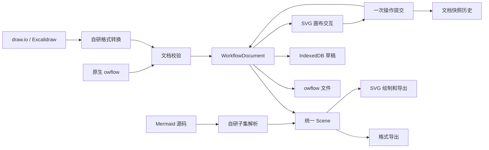

# 架构

Open Workflow 把三种表达方式统一到自己的场景模型中。Vue 3 管理工作台和编辑界面，Tauri 2 管理原生窗口与文件访问；SVG 绘制、交互、布局、Mermaid 解析和格式转换均由仓库内的代码实现。

## 数据流

图中的 Mermaid 代码仅用于文档展示，应用不依赖 Mermaid 运行库。

## 模块边界

| 模块 | 职责 |
| --- | --- |
| `src/App.vue` | 工作台、标签、当前文档、文件保存、草稿调度、全局快捷键与关闭确认 |
| `src/core/types.ts` | 文档、场景、形状、连线、笔迹和样式契约 |
| `src/core/documents.ts` | 版本和容量校验、模板、内容比较、快照历史 |
| `src/core/geometry.ts` | 边界、命中、形状交点、连线路径、场景范围 |
| `src/core/layout.ts` | 无第三方布局依赖的确定性分层布局 |
| `src/core/svg.ts` | 文本转义、基本 SVG 图元、场景导出及内嵌图片限制 |
| `src/components/SceneEditor.vue` | 工具、选区、手势、视口、文字编辑、属性面板 |
| `src/core/mermaid.ts` | 带行列诊断的流程/时序语法子集编译 |
| `src/components/MermaidEditor.vue` | 源码输入、延迟预览、错误定位和创建流程图副本 |
| `src/formats/` | draw.io 与 Excalidraw 的基础结构转换和兼容提示 |
| `src/core/files.ts` | 文件识别、转换协调、导出、浏览器下载 |
| `src/core/storage.ts` | IndexedDB 草稿事务、读取校验与删除 |
| `src/native.ts`、`src-tauri/` | 原生桥接、用户选择路径、文件版本检查和原子替换 |

## 场景与交互

文档使用独立于 DOM 的 JSON 数据。形状保存世界坐标和尺寸，连线使用稳定 ID 绑定节点，笔迹保存点列；元素数组顺序决定绘制层级。视口平移缩放只改变坐标转换，不修改文档中的几何数据。

绑定边的可见端点通过节点边界求交获得。节点移动或调整尺寸后，SVG 使用最新场景重新计算路径。直线和正交线采用基本几何路由，没有障碍物避让或复杂布线求解器。

画布在手势开始时保存场景起点，移动中维护本地预览，抬起时发出一次 `change(scene, label)`。取消手势恢复起点；选择、平移和缩放不写入文档历史。切换标签、保存或执行历史操作前，外壳调用编辑器 `flush()` 提交未完成的文字编辑。

自动布局从节点的入边关系计算层级，再按方向安排节点。它保留锁定图形位置，对环路采用确定性回退；没有声称全局最优、最少交叉或自动解决全部重叠。复杂图仍可手动调整。

## 文档历史与保存状态

每个标签维护自己的 `DocumentHistory`。相同内容不会重复入栈；正常编辑清除后续重做，撤销和重做恢复完整快照。历史限制为最多 60 份快照，按估算字符串大小执行约 24 MiB 预算；至少保留当前和前一快照，因此两个大文档快照可以超过该预算。历史不持久化到文件或草稿。

`contentKey()` 比较实际可编辑内容，时间戳和磁盘路径不参与比较。文件保存捕获调用时的文档快照；异步写入期间发生的新修改不会被标记为已保存。文档的 `savedKey` 与草稿写入状态分别记录，避免把“草稿已保存”误当成文件已更新。

## 本地存储与文件访问

草稿按文档 ID 存入 IndexedDB。修改经过短暂延迟后触发写入，同一文档的任务串行执行，避免旧快照覆盖较新的快照；每次写入以事务完成事件判断成功。读取时重新校验数据，损坏草稿跳过并提示，原记录不自动删除。主题、侧栏偏好和会话标签 ID 使用少量 `localStorage`。

草稿仅存在当前设备的当前工作区，浏览器卸载前的异步操作也不能保证在进程被强制终止时完成。需要长期保存或迁移的内容应写入 `.owflow`。同一草稿的多窗口并发编辑没有合并协议，最后完成的写入可能覆盖其他窗口的草稿。

浏览器通过文件选择器读取、通过下载保存。桌面版通过 Rust 系统文件选择器授予本次会话的路径权限；覆盖原文件时校验 SHA-256 版本，再写入同目录临时文件并替换。重启后从草稿恢复不会复用磁盘路径授权。具体平台限制及剩余的文件并发竞争边界见 [DESKTOP.md](DESKTOP.md)。

## 文本和格式边界

Mermaid 源码是该文档的事实来源，编译结果只用于预览、导出和创建独立流程图副本；没有从任意画布反推源码的双向同步。延迟输入合并一次文本提交，无法识别的语法保留原文并报错。

外部格式转换后保留 `importSource`，使用户可以取回导入时的完整文本。它不是对未知高级属性的可编辑支持，也不会把后续画布修改合并回原文。转换详情见 [FORMATS.md](FORMATS.md)。

SVG 输出对文字和属性做转义，图片只接受受限的内嵌 PNG/JPEG/WebP；不执行导入文档的 HTML、脚本或远程资源。draw.io 的压缩 XML 用通用压缩库 `fflate` 解压，解析后映射到自己的数据结构。

## 检查与扩展

`npm test` 覆盖文档校验、保存往返、历史、几何、绑定、布局、SVG 转义、Mermaid 诊断及外部格式转换。`npm run test:browser` 检查真实 Chromium 中的绘制、拖动、撤销、导入导出、草稿、关闭保护和窄屏界面；桌面 Rust 测试检查文件授权、外部修改冲突和写入行为。CI 的平台构建成功不能代替对应系统的实机交互验收。

新增可编辑图元时，应同时更新类型、校验、几何、SVG、编辑交互和相关导出；外部格式不支持的部分需要明确提示。若改变原生文档语义，应增加格式版本和迁移逻辑。协作、云同步、高级布局或新的语法类型可以独立扩展，当前实现没有这些服务。
