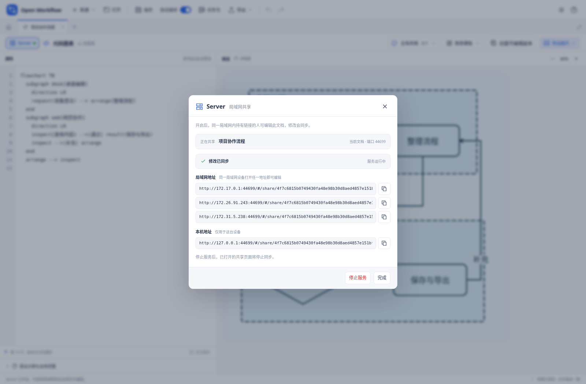
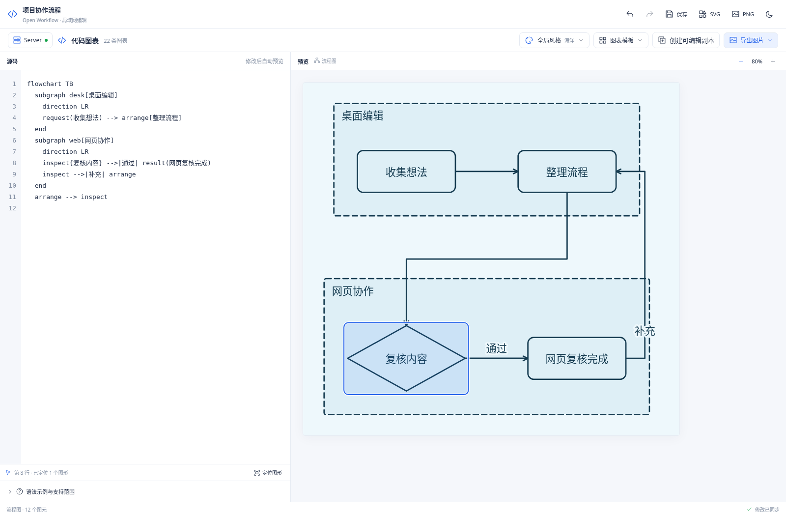

# 局域网共享

Server 让同一局域网内的设备通过网页编辑桌面端当前共享的文档。画布与代码图表使用同一套编辑器，网页修改会同步回桌面，桌面修改也会同步到网页。

## 开启与访问

1. 在桌面端打开需要共享的画布或代码图表。
2. 点击编辑工具栏最左侧的 **Server**；尚未运行服务时会直接开启，并显示共享面板。若开启失败，可在面板中重试“开启服务”。
3. 复制面板中的局域网地址，在同一网络的另一台设备上打开；无法自动复制时，按提示复制已选中的地址。
4. 编辑后检查同步状态；需要写入桌面磁盘文件时，在桌面端点击“保存”。

服务默认关闭。普通网页版的 Server 入口说明如何连接桌面端，浏览器本身不能启动监听服务。网页地址由正在运行的桌面应用提供，不需要另行部署网站，也不是云端链接。

服务一次固定共享一份文档。桌面切换标签后，原文档继续共享；需要共享另一份文档时，在该文档的 Server 面板中选择“改为共享当前文档”。“停止服务”、关闭正在共享的文档或退出桌面应用都会结束会话，原链接随即失效。再次开启时使用面板给出的新地址。

运行中点击 Server 只查看设置。点击“停止服务”后，当前面板保持打开，可选择“开启服务”重新启动；关闭面板后再次主动点击 Server 也会重新开启。

停止前会取回服务已接受的最后版本。若此时桌面仍有不同的本地修改，网页版本会保留为独立文档，方便另行保存；关闭标签或退出时仍会检查这些未保存内容。

## 编辑、保存与图片导出

网页编辑的画布内容、代码图表源码与全局风格都会参与同步。网络同步独立于桌面顶部“保存”旁的自动保存开关：关闭自动保存只停止桌面本地草稿的自动写入，不会暂停共享，也不会使网页变成只读。

共享网页固定编辑这一份文档，不提供新建、打开其他文件或重命名入口；可使用原有绘图工具、代码模板、撤销重做和外观设置。代码图表的“创建可编辑副本”会下载独立 `.owflow` 文件，不切换正在共享的文档。

“已同步”表示修改已提交到当前共享会话，不表示磁盘文件已经更新。共享服务中的文档保存在运行中的应用内，桌面原文件仍需要手动保存；网页可以下载 `.owflow` 副本，不能直接取得桌面文件路径或写入任意文件。

代码图表可直接使用工具栏的“导出图片”，选择“PNG 图片”或“SVG 矢量图”。导出包含当前全局风格下的完整图表，不包含左侧代码或光标高亮。画布仍可从右键菜单导出整图或选区。图片是静态结果，继续编辑请保存原生文档。

共享内容不包含导入时保留的原始文件文本。因此，从共享网页下载的原生副本保留当前可编辑内容，但不包含桌面文档的“导入时的原文件”。具体字段见 [格式说明](FORMATS.md#原生-owflow)。

## 并发修改与断线

每次提交都携带自己基于的共享版本。桌面或另一网页已经提交新版本时，较旧的修改不会自动覆盖它；界面会显示冲突，等待选择“采用远端版本”或“保留我的修改”。前者替换当前内容，后者将当前内容作为新版本提交；提交前仍会检查远端版本是否又有变化。两份修改不会按元素或代码行自动合并。需要保留两份内容时，先下载本地副本，再选择远端版本。

进行中的绘图手势、文字输入和源码编辑会先保留在当前编辑器中，远端快照不会中途替换这些内容。完成编辑后，应用再处理同步或冲突。

接收远端版本后，撤销历史从该版本重新开始；本地“撤销”不会越过这个基线来抹除另一端的修改。

断线时，当前页面保留已加载文档和本地修改，可以通过顶部“保存”下载原生副本。可在 Server 面板选择“重试同步”；重新连接后仍会检查版本，远端也有修改时进入冲突流程。服务停止或重新开启后，旧链接无法连接新的会话，需要从桌面重新复制地址。

共享页不读写普通工作台的本地草稿库；刷新会重新读取远端当前版本，不能恢复仅保留在页面内的未同步修改。存在未同步或进行中的编辑时，关闭或刷新会触发浏览器离开提示。关闭页面前，请先确认同步完成或下载副本。

## 地址与访问范围

访问链接包含随机授权信息，持有完整链接的设备可以查看和修改当前共享文档。停止服务会撤销本次链接，重新开启会生成新的链接。服务用于可信局域网内的临时编辑，使用 HTTP 连接；不提供账号、分级权限或云端备份。

两台设备应连接同一可互通的网络。若无法访问，请确认桌面应用与 Server 仍在运行，并允许系统防火墙中的对应局域网连接；部分访客网络会隔离设备。本机地址只能在运行桌面应用的电脑上使用，其他设备应使用面板显示的局域网地址。

共享传输的是完整文档快照，保留原生文档与图片容量限制；包含大量图片或复杂图表时，网络传输和渲染可能需要更久。当前不提供共享光标、多人操作自动合并、云同步或账号服务。
